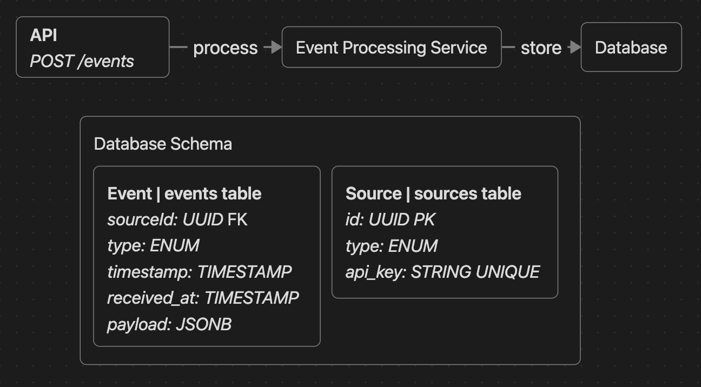
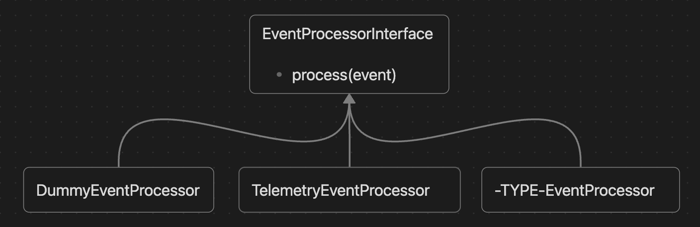

# ADR-001: Start with a syncronous, naive baseline

## Requirements

- [001: Project Baseline](../reqs/001-project-baseline.md)

## High-Level Design

## Low-Level Design

## Tech Stack

- Backend: [Go](https://go.dev/)
    - Why? Because I need a language that makes concurrency, the deployment of lightweight services, and instrumentation cost-effective, allowing me to focus my efforts on design decisions.
- Database: [Postgres](https://www.postgresql.org/)
    - Why? Although the project description leans toward wide-column databases (Cassandra/DynamoDB) due to the high volume of writes, I am interested in exploring the limits of a relational database.
- Observability and monitoring: [Prometheus](https://prometheus.io/) and [Grafana](https://grafana.com/)
    - Why? Because they are the industry standard for observability and monitoring.
- Infrastructure: [Floci](https://floci.io/)
    - Why? Because I don’t want to spend too much time on local infrastructure, and Floci provides the ideal environment for this. Furthermore, it will make things easier if I decide to deploy the project to the cloud.
